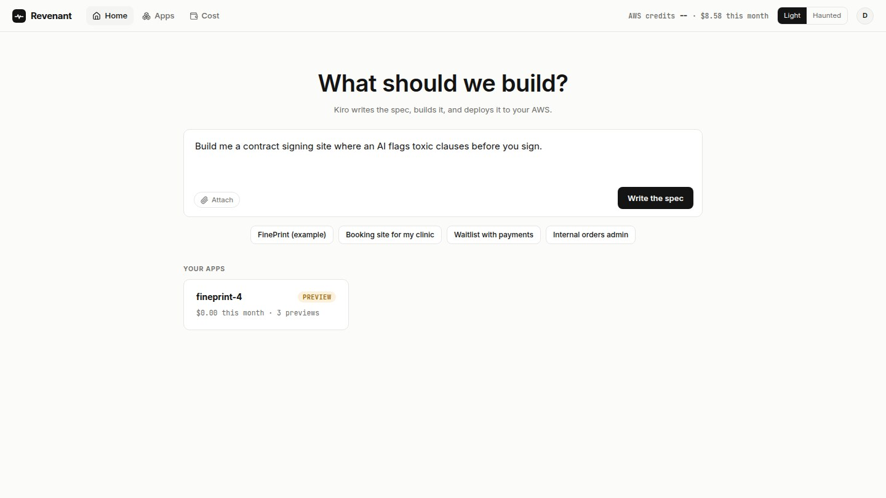
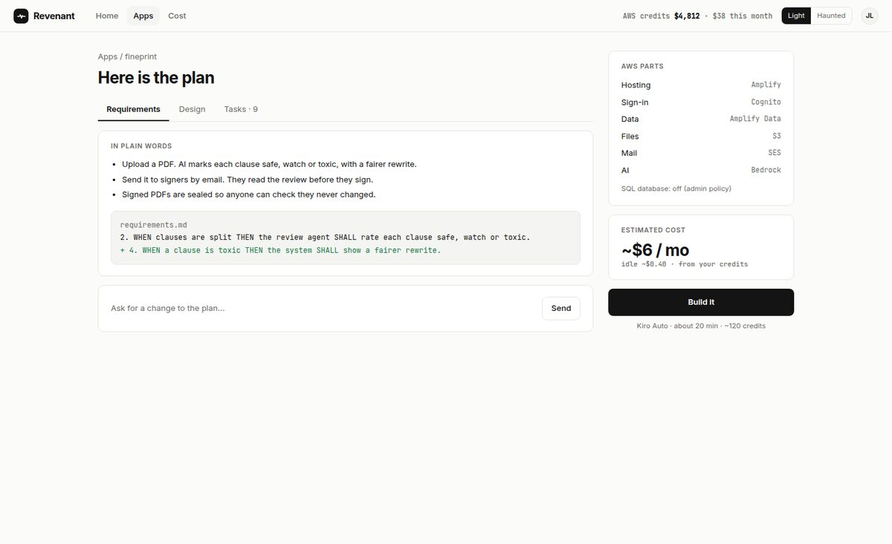
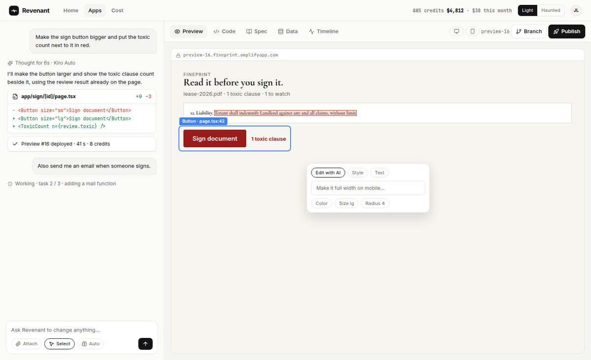
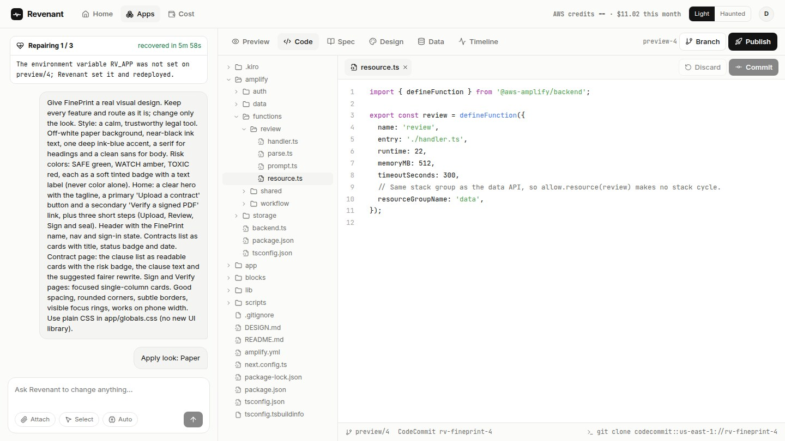
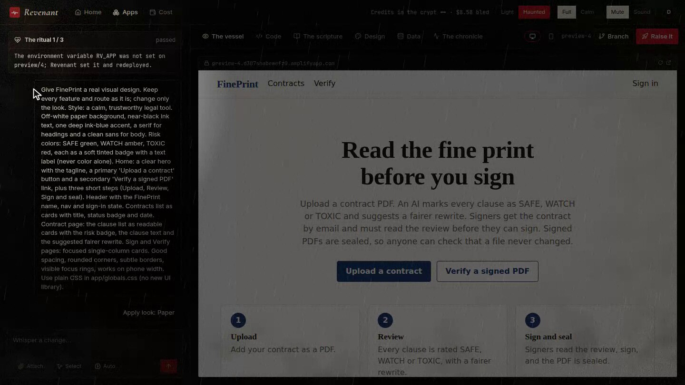
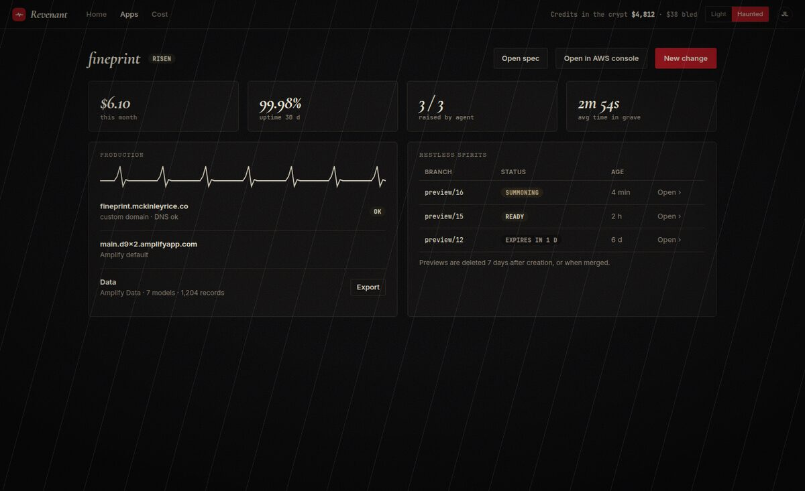
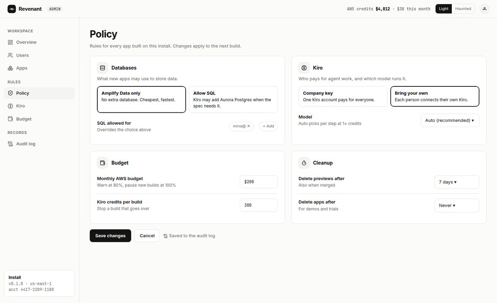

# Revenant

**Lovable on your own AWS account.** Say what you want. A Kiro agent writes the spec, builds
the app on Amplify Gen 2 and deploys it into your AWS account, paid from your own AWS bill
and credits. When a build or deploy dies, the agent reads the logs, fixes it and brings it back.

Built for Kiroween 2026 (Frankenstein category). Open source, MIT.

> Status: every part is written; the first end-to-end run on a real AWS account is still to
> come. The screenshots below are from the clickable mockups in [design/mockups](design/mockups),
> so the figures in them are sample data.

## What it is

A self-hosted app builder. You install it once into your AWS account with one CloudFormation
stack. After that, anyone you invite signs in with an email code, asks for an app in plain
words, edits it like Lovable or v0, and publishes it. Every generated app is a normal
Amplify Gen 2 app with its code in CodeCommit, so it keeps running if Revenant is removed.

Revenant is stitched together from parts that were never meant to meet, which is why it is
a Frankenstein entry: a Lovable-style builder, Kiro CLI running headless in CodeBuild,
a CloudFormation installer and a self-healing repair agent.

## Why

Companies that want everything on AWS pay per seat for hosted builders, and hand those
vendors their code, data and infrastructure. That adds a security review, a second cloud
to audit and lock-in. Revenant gives them the same build-and-ship experience inside their
own account.

- **You own everything.** Code in CodeCommit, one Amplify Gen 2 app per app, data in your
  account. Uninstalling Revenant leaves every app running.
- **No seats.** You pay your own AWS bill, and spend your AWS credits if you have them.
  Every screen shows credits left and what each app costs.
- **Spec first.** Kiro writes requirements, design and tasks before any code. You edit the
  spec, and nothing is built until you press "Build it".
- **Fixes itself.** Failed builds and deploys are repaired by the agent, with the cause,
  the fix and the time to recover on record.

## 60-second tour

**1. Ask.** The home screen shows AWS credits left and this month's spend, and takes a
request in plain words: "Build me a contract signing site where an AI flags toxic clauses
before you sign."



**2. Spec first.** Kiro writes `.kiro/specs/<app>/` (requirements, design, tasks), with the
AWS parts and the estimated monthly cost. You edit it, then press "Build it".



**3. Build and edit.** Kiro CLI builds the app in CodeBuild, one commit per task. Each change
gets its own Amplify preview with its own data. Chat on the left; on the right, **Select**
any element in the preview to see its file and line and edit it.



**4. Or edit the code.** The Code tab commits straight to the preview branch; the agent picks
up from your commit.



**5. It dies, it rises.** When a run, build, deploy or health check fails, a repair run reads
the logs, states the cause in one sentence, fixes it on `revenant/fix-<n>`, checks it,
merges and redeploys (up to 3 tries). Shown here in Haunted mode.





**6. One policy.** `/admin` sets the rules for the whole install, and every change goes to
the audit log.



Every screen in both themes: open [design/mockups/flow.html](design/mockups/flow.html). The
theme and the scare: [design/mockups/live.html](design/mockups/live.html).

## Install

Both ways deploy the same template, [infra/install.yaml](infra/install.yaml). It asks for a Kiro API key,
an admin email and a monthly budget. We recommend a dedicated AWS Organizations member account.

1. One click: [Launch the install stack](https://console.aws.amazon.com/cloudformation/home#/stacks/quickcreate?stackName=revenant&templateURL=https://its-janghoon-revenant.s3.amazonaws.com/install.yaml)
   (needs the template published to that URL; until then use way 2).
2. AWS CloudShell, one line:

```
curl -fsSLo install.yaml https://raw.githubusercontent.com/its-janghoon/revenant/develop/infra/install.yaml && aws cloudformation deploy --template-file install.yaml --stack-name revenant --capabilities CAPABILITY_NAMED_IAM --parameter-overrides KiroApiKey=YOUR_KIRO_KEY AdminEmail=you@example.com Budget=100 --tags revenant:app=revenant revenant:install=revenant
```

The stack copies this repository into CodeCommit in your account, bootstraps CDK, and starts
the first Amplify build (about 15 minutes). The `RevenantUrl` output is your Revenant; the admin
gets a Cognito invite email. To update later, run the `UpdateCommand` output.

### Publishing the template (maintainers)

The one-click link only works with a template in S3. After each release on `main`, upload
`infra/install.yaml` to an S3 bucket you own (here `BUCKET`, any region) and point the link at it:

```
aws s3api put-public-access-block --bucket BUCKET --public-access-block-configuration BlockPublicAcls=true,IgnorePublicAcls=true,BlockPublicPolicy=false,RestrictPublicBuckets=false
aws s3api put-bucket-policy --bucket BUCKET --policy '{"Version":"2012-10-17","Statement":[{"Effect":"Allow","Principal":"*","Action":"s3:GetObject","Resource":"arn:aws:s3:::BUCKET/install.yaml"}]}'
aws s3 cp infra/install.yaml s3://BUCKET/install.yaml --content-type text/yaml --cache-control no-cache
aws cloudformation validate-template --template-url https://BUCKET.s3.amazonaws.com/install.yaml
```

Only `install.yaml` is public; keep everything else in the bucket private. The link is
`https://console.aws.amazon.com/cloudformation/home#/stacks/quickcreate?stackName=revenant&templateURL=https://BUCKET.s3.amazonaws.com/install.yaml`;
the link above is a placeholder until the bucket exists.

### Kiro Crew app

[crew-app/](crew-app/README.md) drives a Revenant install from Kiro Crew chat: MCP tools
`create_project`, `build`, `publish` and `status`, a monitor that notifies you when a build,
deploy or repair finishes, and a dashboard page with every project's status and cost.

## How it works

1. **Sign in** with an email code (Amazon Cognito, no password, invite only).
2. **Ask** in plain words. Revenant creates a CodeCommit repo for the project.
3. **Spec.** Kiro writes `.kiro/specs/<app>/` with the AWS parts and the estimated monthly cost.
4. **Build.** Kiro CLI runs headless in CodeBuild (`kiro-cli chat --no-interactive`), one commit
   per task. Lint, synth, cfn-lint and the guardrail check run as scripts, not agent turns.
   The push starts an Amplify preview with its own URL and its own data.
5. **Edit** in chat, with **Select** in the preview, or in the **Code** tab.
6. **Publish** merges to `main` and deploys production. A replace or delete waits for your approval.
7. **Repair.** EventBridge rules catch failed runs, builds and deploys. Common causes (a missing
   environment variable or Amplify secret) are fixed by rules at no Kiro cost; everything else
   goes to a repair run, up to 3 tries.

### Data

- **Amplify Data by default.** Every preview branch has its own tables with seeded sample data.
- **SQL when the admin allows it.** Aurora Serverless v2 Postgres with dev, prod and a
  database per preview; Publish shows the migration and snapshots prod first.
- No public database, no VPC Lambda, no NAT gateway.

### Admin

`/admin` sets the rules for the install: SQL on or off (for everyone or per user), the Kiro
model (Auto by default), who pays for Kiro (company key, **bring your own Kiro**, or both),
the monthly budget and an auto-delete period. Every change goes to the audit log.

### Light and Haunted

One switch in the header. **Light** is plain with no effects. **Haunted** is dark: deploys
die under a tombstone, repairs are rituals, live apps have risen, with a flashlight, rain
and thunder made in the browser. **Calm** keeps the dark look and turns every effect off.
The theme never changes behaviour.

**Logo: Pulse.** A flat line that beats once, on a rounded square: dark ink in Light, blood
red `#b3121c` in Haunted. It is the heartbeat Revenant draws for every app: beating while
live, flat when a deploy dies, beating again when it is fixed
([design/mockups/logos.html](design/mockups/logos.html), option A).

### Demo app

Request: "Build me a contract signing site where an AI flags toxic clauses before you sign."
The result is **FinePrint** (subtitled "Blood Oath" in Haunted).

## How Kiro was used

Kiro is used twice: Kiro agents, orchestrated by Kiro Crew, wrote this repository, and Kiro
CLI is the engine inside every install. In short:

- **Specs:** [.kiro/specs/revenant](.kiro/specs/revenant) (17 requirement sections in EARS
  style, design, tasks split into waves and lanes) came first and changed before code did.
- **Steering:** [.kiro/steering](.kiro/steering) (`product`, `tech`, `structure`, `git`) kept
  parallel agents consistent; [steering/](steering) is the steering every generated app gets.
- **Kiro Crew:** parallel lane subagents in their own worktrees, a monitor loop that merged
  lanes by reading pushed branches, an hourly cron for the credits log, learned lessons.
- **Property-based tests** (fast-check) for the guardrail rules, the change classifier, the
  data-model guard and the runner log format.

The full write-up with a dated log: [docs/kiro-usage.md](docs/kiro-usage.md). Kiro credits
per turn: [docs/credits.md](docs/credits.md).

## Docs

- Spec: [.kiro/specs/revenant](.kiro/specs/revenant)
- Mockups: [design/mockups](design/mockups)
- Host your own, public or private: [docs/self-host.md](docs/self-host.md)
- Hosting for outside customers: [docs/platforms.md](docs/platforms.md)
- How we used Kiro: [docs/kiro-usage.md](docs/kiro-usage.md)
- Demo video storyboard: [docs/storyboard.md](docs/storyboard.md)

## License

[MIT](LICENSE)
